<p align="center">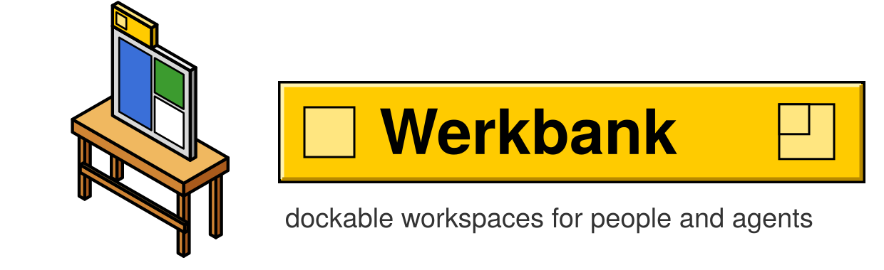</p>

<p align="center">A framework for work applications made of dockable panels that a person and an AI agent operate together.<br>
Every action is a command, every panel can describe its data, and any coding agent can drive the app over MCP.</p>

<p align="center">
<a href="https://github.com/julian-hilg/werkbank">github.com/julian-hilg/werkbank</a> ·
<a href="INSTALL.md">Install</a> ·
<a href="packages/framework/GUIDE.md">Guide for building apps</a> ·
<a href="DEVELOPMENT.md">Development</a>
</p>

<p align="center">
<a href="https://github.com/julian-hilg/werkbank/actions/workflows/ci.yml"></a>
<a href="LICENSE"></a>
</p>

<p align="center">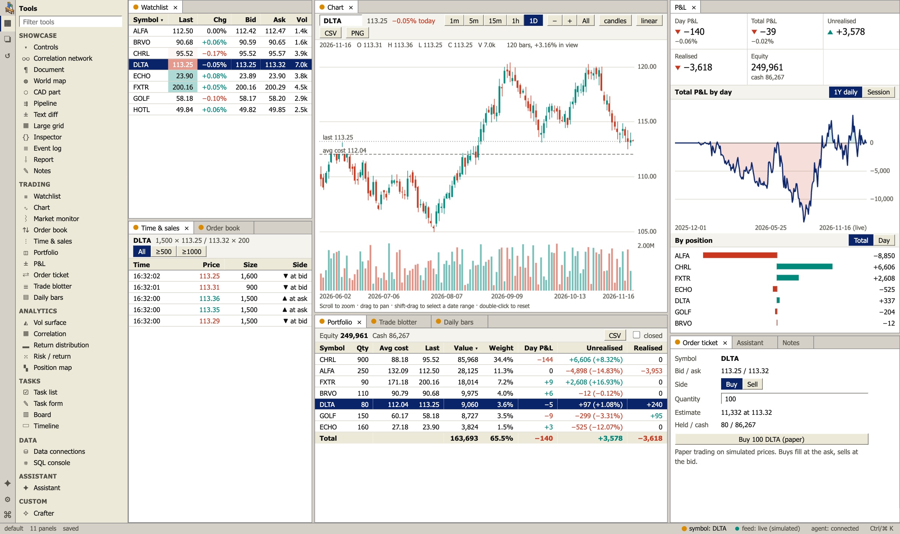</p>

## Features

- **Dockable panels.** Every panel is a tab you can drag, split, stack, maximise or move to its own window. A workspace is data: saved, restored, exported, and shipped as presets.
- **Built for agents from the start.** Every action is a typed command and every panel returns the data behind its pixels. An agent connected over MCP reads the app and drives it; so does the Assistant panel inside it.
- **Agent-agnostic.** Use Claude Code, Codex or any MCP client. A setup window gives the one-line command and a briefing written for the app. The model is the agent's business, not the app's.
- **Safe by construction.** Agent actions are logged with who did them and can be undone. Anything external or irreversible waits for the person's approval.
- **Build your own panels inside the app.** Describe a panel and an agent builds it. It runs in a sandbox with no network access, can use ECharts, D3, Chart.js, Lightweight Charts and Plotly, and has a reviewed route into the shared app.
- **A framework, not a template.** An app depends on Werkbank as a package and owns only its panels, commands, settings and workspaces. `npm run werkbank:update` brings in a new framework version.
- **Its own controls and themes.** Dropdowns, searchable selects and search fields with previews look the same in every browser. A theme is one block of tokens; three ship.
- **Documented where it is used.** Every app has a Documentation section in its settings, and the package carries a guide for coding agents that build on it.
- **A skill for building on it.** Every new app comes with a skill that takes a coding agent through a feature in a fixed order, backend then frontend, with a rule check at the end, so apps built by different people and agents come out alike.

## How it fits together

An app runs in the browser. A small local process, the bridge, is the only way in for agents: it speaks MCP to them and a WebSocket to the app. Whatever an agent does goes through the same command registry as a click.

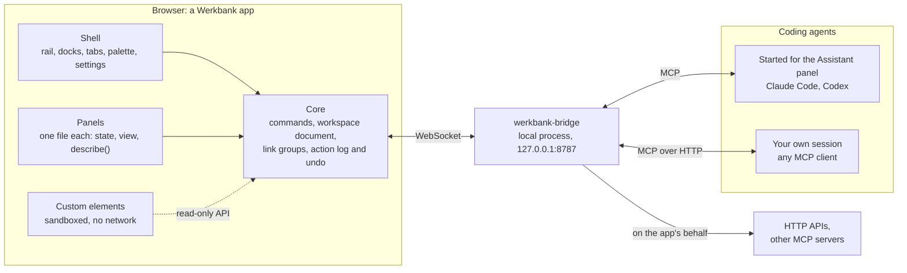

Two rules follow from this picture and shape every app built on Werkbank:

1. **Everything the app can do is a command** with a typed input and a risk class, so a person (palette, keys, buttons, menus) and an agent (MCP) can do exactly the same things.
2. **Everything a panel shows is also data**: each panel returns the rows and numbers behind its view, so an agent reads the app instead of looking at pixels.

## Quick start

```bash
git clone https://github.com/julian-hilg/werkbank.git
cd werkbank
npm install
npm run dev          # http://localhost:5199, plus the agent bridge
```

To start an app of your own:

```bash
npm run new:app -- ../my-app "My App" --from release
```

See **[INSTALL.md](INSTALL.md)** for requirements, connecting an agent, and prompts you can give a coding agent to do any of this for you.

## Building on it

An app is one definition and one file per panel:

```ts
export const werkbank = new Werkbank({
  appId: "ledger",
  title: "Ledger",            // the app's name and logo are fixed here
  logo: "/logo.svg",
  tools: [accounts, entryForm, chatTool, crafterTool],
  topics: { account: z.string().nullable() },   // what linked panels share
  commands: entryCommands,                      // what people and agents can do
  settings: [...],
  docs: [...],                                  // the app's own documentation pages
  defaultWorkspace: {...},
});
```

| If you are | Read |
| --- | --- |
| A coding agent building an app | The [`werkbank-app` skill](packages/framework/skills/werkbank-app/SKILL.md), which every new app has in `.claude/skills/` |
| Building an app, or a coding agent doing so | [`packages/framework/GUIDE.md`](packages/framework/GUIDE.md): panels, commands, settings, forms, charts, workspaces, agents, and the rules that keep an app updatable |
| Updating an app to a new version | [`docs/upgrading.md`](docs/upgrading.md) |
| Working on Werkbank itself | [`DEVELOPMENT.md`](DEVELOPMENT.md) |
| Curious why it is built this way | [`docs/design.md`](docs/design.md) |
| Letting people build panels in your app | [`docs/custom-elements.md`](docs/custom-elements.md) |

### Building with a coding agent: the `werkbank-app` skill

An app has two halves. The **backend** is its data and what can be done with it: one schema per record, a store that holds facts, and commands with a risk class and an undo. The **frontend** is the panels that show that data and call those commands. The skill makes an agent build them in that order, and treats the backend as finished only when an agent could do the task with no panel on screen. That is what keeps every panel readable and operable over MCP.

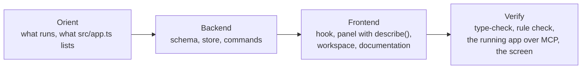

| The skill gives an agent | |
| --- | --- |
| `SKILL.md` | The workflow and the rules that do not bend |
| `backend.md`, `frontend.md` | The patterns to copy, each with a checklist |
| `npm run check:rules` | Finds literal colours, native dropdowns, imports from inside the packages, panels without `describe`, panels using browser storage, Alt-key shortcuts and unlisted tools |
| `npm run dev:status`, `dev:stop` | Shows what answers on the app's and the bridge's port and which process holds them, and stops the ones that belong to the app |

An app made with `npm run new:app` has the skill in `.claude/skills/werkbank-app/`, where Claude Code loads it by itself, and `npm run werkbank:update` keeps it at the installed framework version. Other agents are pointed to it by the app's `AGENTS.md`. To have it in every project, or in an app made before it existed, see [INSTALL.md](INSTALL.md#the-skill-for-coding-agents). It is for building apps; panels made inside a running app with the Crafter follow [`docs/custom-elements.md`](docs/custom-elements.md).

### How a framework update reaches an app

The shell, the controls, the assistant, the bridge and the in-app documentation live in the packages. An app owns only its `src/`, so an update replaces dependencies and merges nothing.

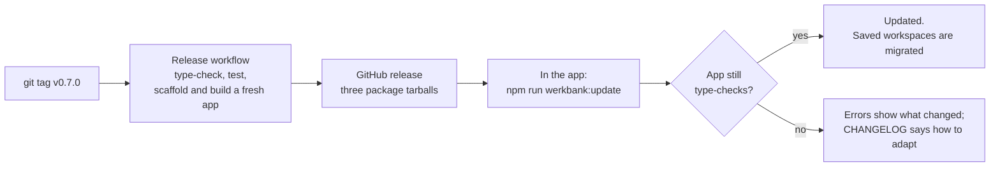

<p align="center">
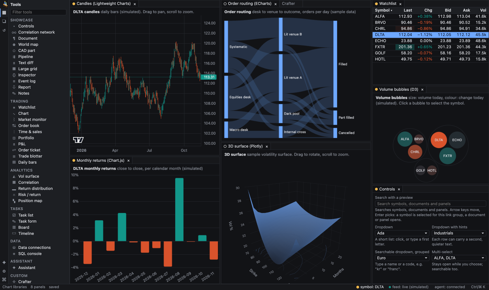
&nbsp;
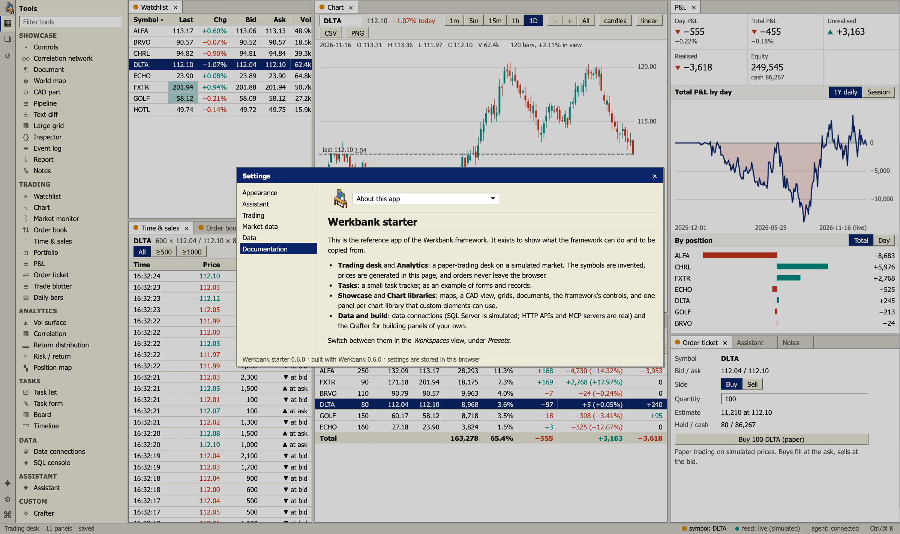
</p>

## What is in here

| Path | What it is |
| --- | --- |
| `packages/framework` | The framework: shell, core (workspace document, commands, linking, undo, settings, custom elements), Assistant and Crafter panels, controls, themes |
| `packages/bridge` | The local process that connects agents to a running app over MCP, and starts an agent for the in-app assistant |
| `packages/chart-libraries` | Chart libraries packed for sandboxed custom elements |
| `starter/` | The reference app: some forty panel types in six workspaces |
| `packages/framework/skills/werkbank-app` | The skill for coding agents that build apps; shipped in the package and copied into every new app |
| `scripts/` | App scaffold, release packing, skill install, and the browser checks |

## The reference app

Everything in it is simulated or sample data: the symbols are invented, market
history is a seeded random walk, the "live" feed is a generator in the browser,
and the tasks, orders and revenue figures are made up. No network, no real
orders. Only the country outlines on the map and the city coordinates are real.

Six preset workspaces (Workspaces view in the rail, or "Preset workspace" in
the palette):

| Preset | Panels | What it demonstrates |
| --- | --- | --- |
| Trading desk | Watchlist, Chart, Time & sales, Order book, Portfolio, P&L, Order ticket, Trade blotter, Daily bars | Streaming data, a zoomable chart from one-minute to daily bars, derived numbers, an action with consequences |
| Analytics | Vol surface, Correlation, Return distribution, Risk / return, Position map, Market monitor | A rotatable 3D surface, a heatmap with method, lookback and clustering controls, a histogram and calendar, a scatter, a treemap, small multiples |
| Showcase | World map, Pipeline, CAD part, Document, Large grid, Text diff, Inspector, Event log, Report | A flat map and a globe with routes, a job graph, a parametric model driven by sliders, markdown, 100,000 virtualised rows, a line diff, the app inspecting itself |
| Chart libraries | Candles, Monthly returns, Order routing, 3D surface, Volume bubbles, Controls | One sandboxed panel per chart library (Lightweight Charts, Chart.js, ECharts, Plotly, D3), and the framework's dropdowns and search fields |
| Data and build | Data connections, SQL console, Crafter, Correlation network, a shipped element | Connections to a SQL Server (simulated), an HTTP API and another MCP server (both real), a SQL console, and building a panel of your own |
| Tasks | Task list, Task form, Board, Timeline | Records, validated forms with drafts, drag between columns, a Gantt chart |

<p align="center">
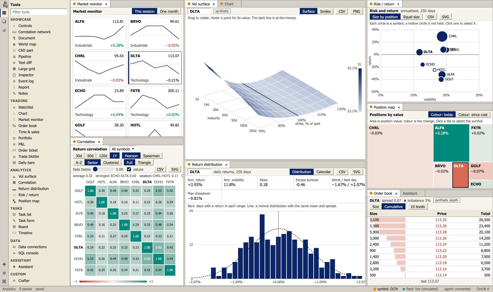
&nbsp;
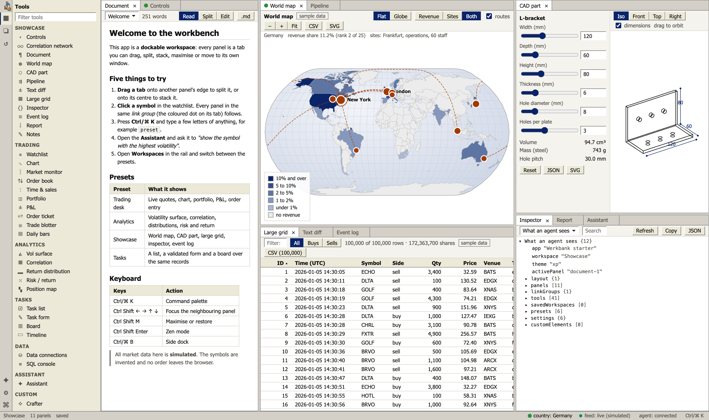
</p>

Every preset also has the Assistant. Panels in one link group share context:
select a symbol, a task or a country in one and the others follow.

**Exports.** Tables export CSV; charts export PNG or SVG; documents export
Markdown; the Report panel builds a Markdown or JSON report from whatever
panels are open, using the same data an agent reads.

**Charts follow a few rules** so they stay readable in every theme and for
colour-blind readers: one axis per chart, one hue for magnitude, two hues with a
neutral midpoint for gain and loss, values available on hover, and a sign or
label wherever colour carries meaning.

Patterns worth copying into a real project:

- **Data lives outside panels.** `market/feed.ts` and `portfolio/ledger.ts` are
  plain stores; tools subscribe through hooks. A hidden tab unsubscribes
  automatically, so background panels cost nothing.
- **Derived, not stored.** The ledger stores only fills. Positions, cash and
  every P&L number are computed from them, and unit tests pin the identities.
- **Stale is not live.** When the feed is paused or reconnecting, prices are
  dimmed and labelled, the ticket is disabled and `order.place` refuses.
  The feed drops its connection by itself every few minutes to keep that path honest.
- **Risk classes on commands.** `order.place` is `external`, so an agent's order
  waits for your approval; yours does not.
- **One schema per record.** `tasks/store.ts` defines a valid task once; the
  form, the commands and storage all validate against it, so an agent cannot
  write what the form would reject.
- **Commands that change app data declare their inverse.** `task.update` and
  its siblings have an `undo`, which is why they are in the action history's
  undo like any layout change.

## Using it

- **Open a panel:** click a tool in the side dock, drag it to a place in the
  layout, or press Ctrl/⌘ K and type. Clicking a tool that is already open
  goes to its panel; drag it into the layout to open the same tool a second time.
- **Rearrange:** drag a tab onto another group to join it, or onto an edge to split.
- **Link panels:** the dot on a tab is its link group. Panels in the same group
  share context (in the starter: symbol and date range). Click the dot to change group.
- **Feed:** click `feed: live` in the status bar to pause or resume the stream, or run
  "Simulate a dropped connection" from the palette.
- **Keyboard:** Ctrl/⌘ K commands, Ctrl+Shift+Arrow focus the neighbouring group,
  Ctrl+Shift+M maximise, Ctrl+Shift+Enter zen mode, Ctrl/⌘ B side dock.
- **Own window:** the ↗ button on a group moves the panel to a separate window.
  Closing that window docks it back.
- **Workspaces:** save, load, export and import named workspaces from the side dock.
- **History:** every action is listed with who did it; "Undo last action" reverts it.

## The assistant, and letting an agent drive the app

There are two ways in, and both end at the same place: the app's command
registry. Open **Assistant setup** (the ✦ button in the rail) to configure
either.

<p align="center">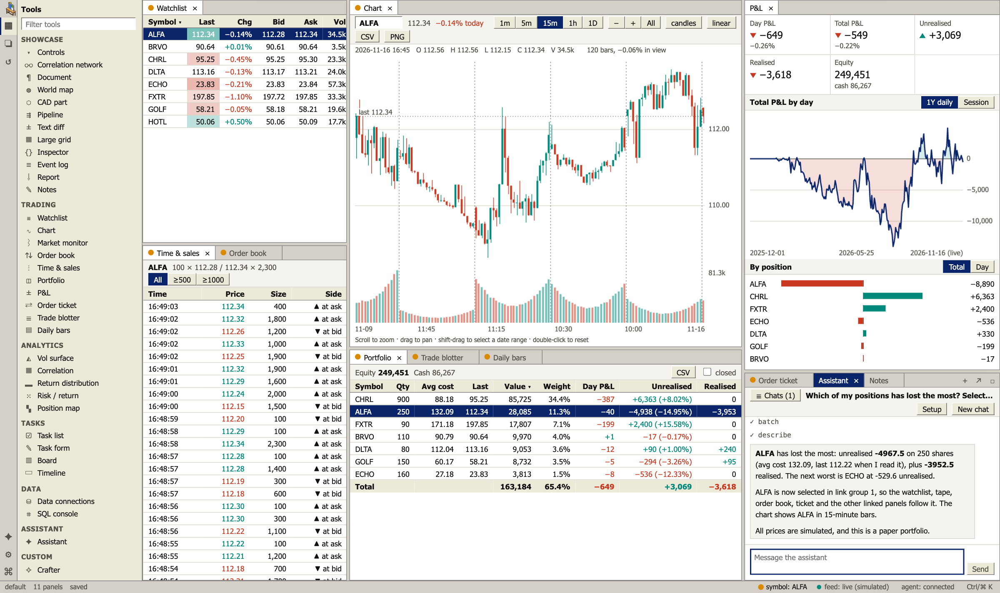</p>

*Above: one request to the Assistant panel, answered by Claude Code. It read the portfolio's data, selected the position that lost the most (every linked panel followed) and changed the chart's timeframe.*

**From inside the app.** Open the Assistant panel and type. Each message goes
to the bridge, which starts a coding agent for that turn: whichever installed
agent you chose in the setup window (Claude Code and Codex have adapters). The
agent reads the app and acts on it through MCP; the panel shows what it is
doing, the commands it ran, and its reply as it is written. Conversations are
kept in a list you can reopen. The agent is started with no file, shell or web
access: the app's commands are the only thing it can use.

**From your own coding agent.** The bridge serves MCP at
`http://127.0.0.1:8787/mcp`, so any agent can connect from a terminal session
in a folder of your choice. The setup window shows the exact command for your
agent (`claude mcp add --transport http …`, `codex mcp add … --url …`, or a
JSON snippet for other clients) and a briefing to paste as your first message.
Both are generated from the app's own configuration, so every app built on the
framework gets its own. The same connection is how other programs use the
app's data: the starter's `sql.query` command, for example.

Either way, agent actions appear in the action history marked "agent" and can
be undone, and anything `external` or `irreversible` waits for your approval
in the app. Several tabs can be open at once: a chat's agent acts on the tab
that started it; an external agent acts on the tab you used last.

What happens when an agent acts:

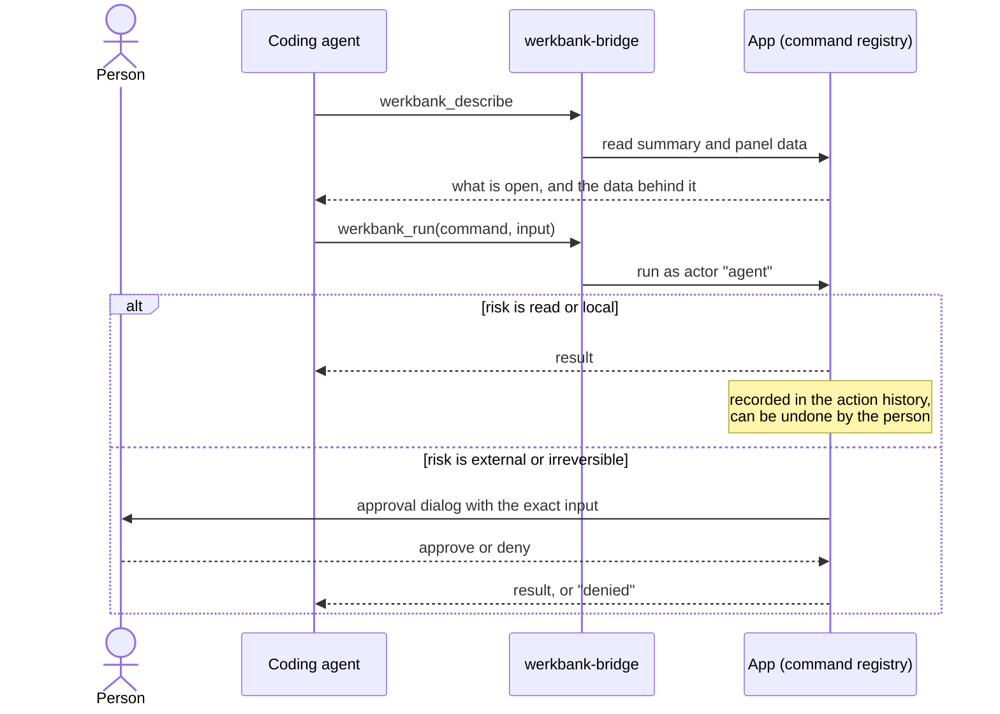

<p align="center">
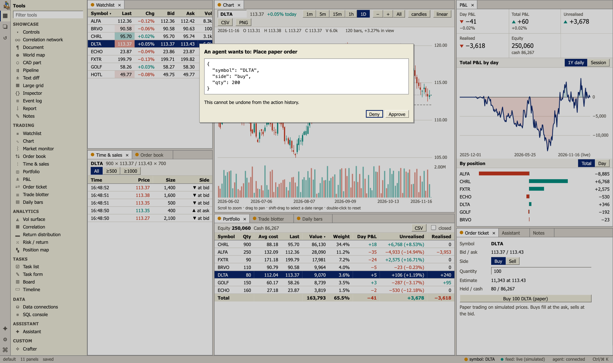
&nbsp;
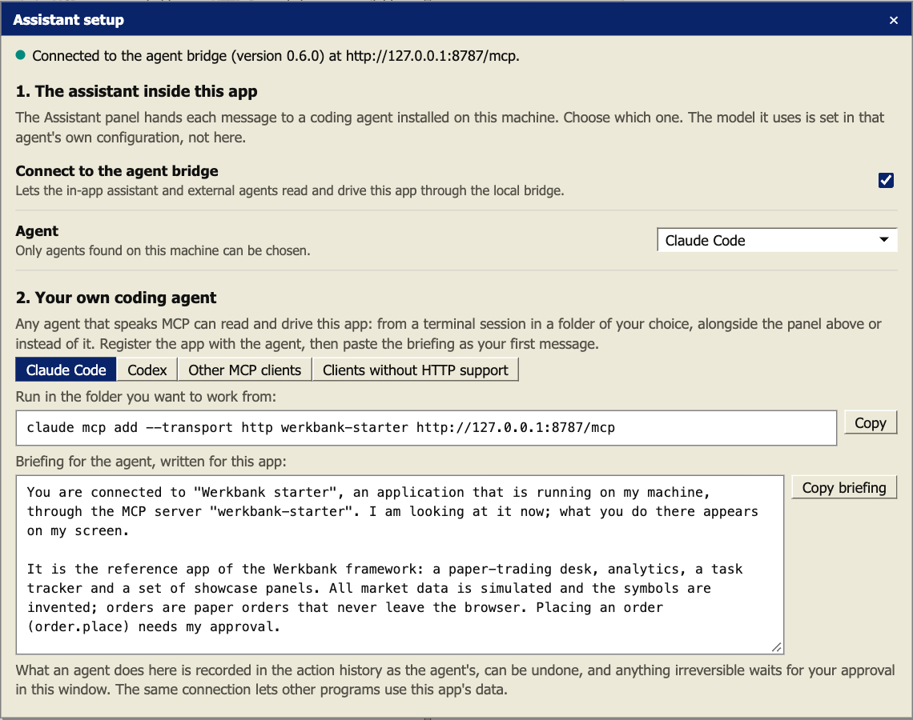
</p>

About streaming: measured in November 2026, Claude Code passes a reply's text
on piece by piece when no tool call precedes it, but after a tool call its
default model, Sonnet and Opus hand over the whole reply at once, while Haiku
keeps streaming. The panel writes such a burst out over about a second.

### What an agent gets over MCP

| | |
| --- | --- |
| **Tools** | `werkbank_describe` (a short summary, or chosen panels in full), `werkbank_commands` (search the commands, fetch input schemas on request), `werkbank_run`, `werkbank_batch` (several commands in order, stopping at the first failure), and `werkbank_element_guide` / `werkbank_save_element` for building custom elements |
| **Resources** | `werkbank://app`, `werkbank://workspace`, `werkbank://commands`, `werkbank://history`, and one `werkbank://panel/{id}` per open panel. Clients can subscribe and are told when a resource changes or the set of panels does |
| **Prompts** | `tour`, `review_actions`, `arrange`, `build_element` |
| **Conventions** | Server instructions, tool titles and annotations (read-only or not), a declared result shape with structured content, and progress notices while an action waits for your approval |

There are few tools on purpose. An app has dozens of commands; exposing
each as its own tool would put every schema in the agent's context on every
turn. Instead the agent reads a compact index, asks for the schemas it needs,
and runs commands through one tool. The same applies to state: the summary is
small, and panel data is fetched per panel.

To add another agent to the in-app assistant, write an adapter in
`packages/bridge/src/agents.js` (how to start it, how to read its output); it
appears in the setup window when its program is installed. The assistant uses
your own agent login and counts against your usage.

## Settings, menus and custom elements

- **Settings** (⚙ in the rail, or Ctrl/⌘ ,) is a window, not a panel: settings
  are occasional and app-wide, and do not belong in a saved layout. An app adds
  its own sections by listing settings in its configuration. Its last section
  is the documentation: the app's own pages, then the framework's.
- **Name and logo** belong to the app and are set in its code. A person can
  hide the logo, not replace it.
- **Right-click** a tab for its actions and link group; rows, cards, the chart
  and the grid have menus of their own. The Menu key opens the same menu.
- **Custom elements** are described in `docs/custom-elements.md`: what they
  can reach, how the sandbox bounds them, and how one is submitted, reviewed
  and shipped.

### A panel of your own, from idea to shipped

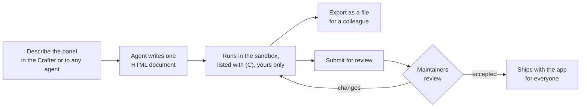

<p align="center">
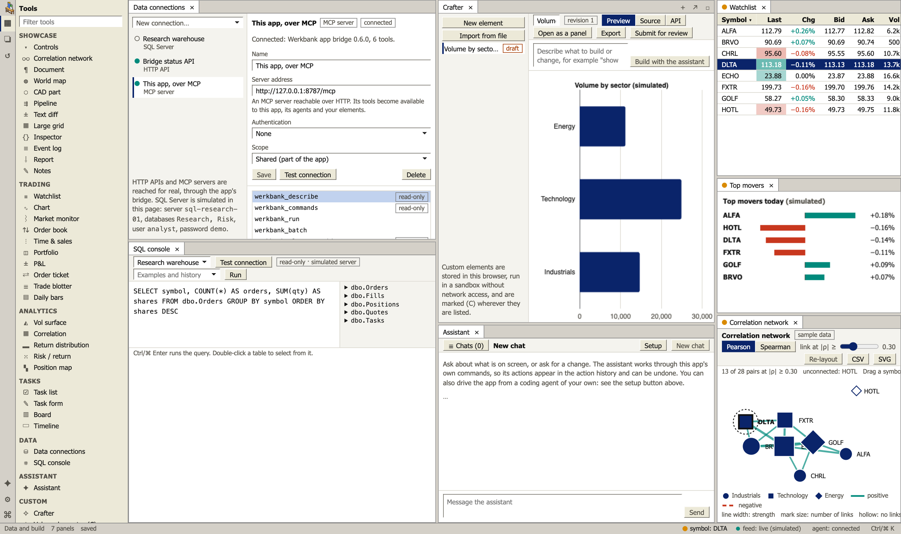
&nbsp;
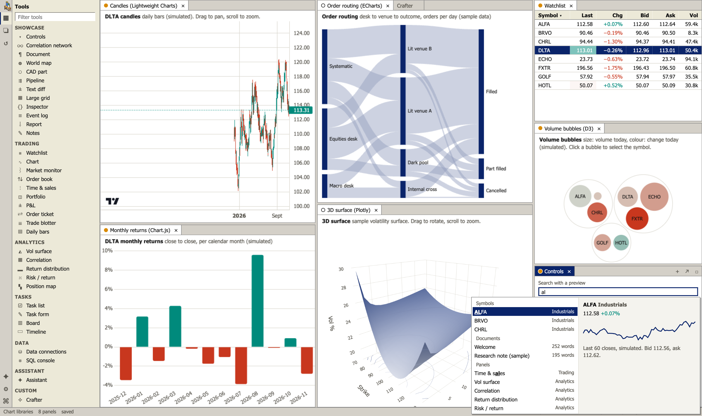
</p>

<p align="center">
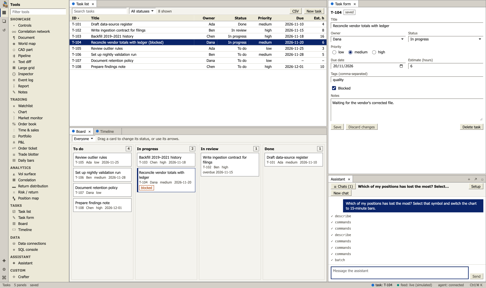
&nbsp;
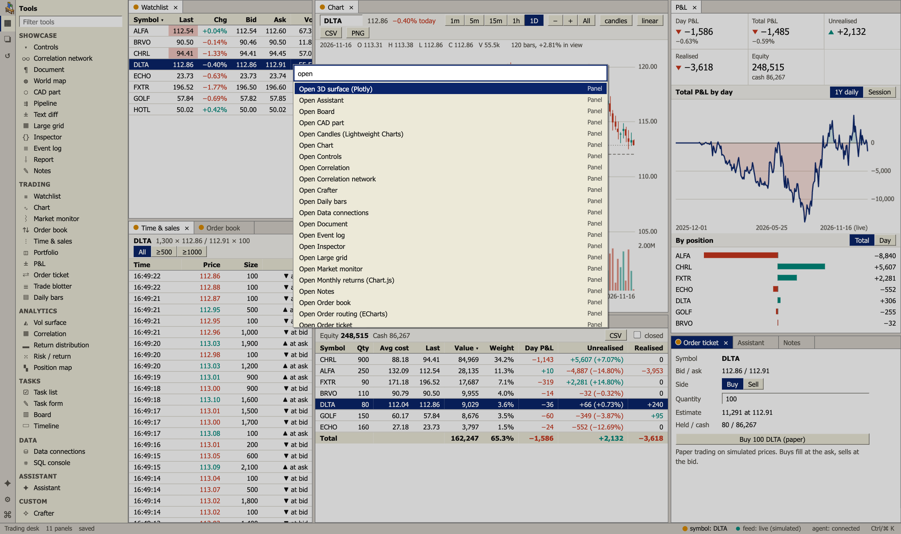
</p>

## Verifying

```bash
npm test             # 117 unit tests
npm run typecheck
npm run check        # 276 checks in a real browser; needs `npm run dev` running
npm run check:app    # a packed release installs, builds and updates in a fresh app
```

## Credits

Country outlines come from [Natural Earth](https://www.naturalearthdata.com/) (public domain) through the `world-atlas` package. The layout engine is [`react-resizable-panels`](https://github.com/bvaughn/react-resizable-panels); markdown rendering is `react-markdown`. The chart libraries offered to custom elements are Apache ECharts, D3, Chart.js, TradingView Lightweight Charts and Plotly, each under its own licence; the texts ship in the package and are listed in [`THIRD-PARTY-NOTICES.md`](packages/chart-libraries/THIRD-PARTY-NOTICES.md).

## Licence

Werkbank is released under the [MIT licence](LICENSE).
Source, issues and releases: [github.com/julian-hilg/werkbank](https://github.com/julian-hilg/werkbank).
